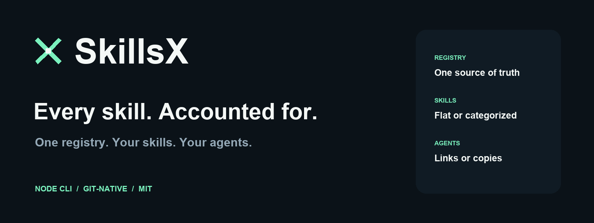
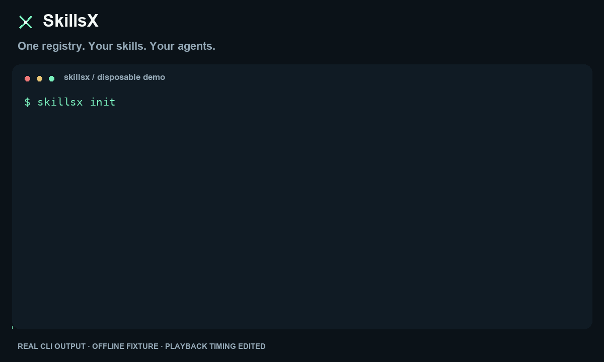

# SkillsX



[](https://github.com/gertyhiler/skillsx/actions/workflows/check.yml)
[](package.json)
[](LICENSE)

**One registry. Your skills. Your agents.**

A dependency-free Node CLI and library for installing, organizing and tracking
agent skills across projects and agent destinations.

[See it work](#see-it-work) · [Get started](#run-locally) · [Registry contract](docs/contract.md) · [CLI reference](#cli)

One `.agents/skills.registry.json` describes every installed skill, its optional
category, source revision, file hashes and agent destinations. No machine-local
ownership database. Clone the repository and verify the same installation.

## See it work



[Watch the MP4](https://github.com/gertyhiler/skillsx/raw/refs/heads/main/docs/assets/demo.mp4)
· [Read the transcript](docs/assets/demo.json)
· [Reproduce the demo](scripts/demo/README.md)

Real CLI output from a disposable offline fixture; playback timing is edited.
The final verification deliberately catches a modified external skill.

| Keep it organized | Keep it accountable | Share it across agents |
| --- | --- | --- |
| Flat skills and optional categories, together. | Hash the entire package. Detect drift without accepting it. | One canonical store, relative links or checked copies. |

## What it does

- Mix flat skills and one-level categories in one installation.
- Register project-authored skills; report unregistered skills as errors.
- Install external packages without rewriting their contents or running scripts.
- Hash every payload file, including references, assets and scripts. Track
  `agents/openai.yaml` separately and preserve the consumer's version on update.
- Fetch pinned Git revisions through the Git CLI: GitHub, GitLab, self-hosted
  servers and other Git remotes use your existing Git authentication.
- Expose one canonical installation to agents directly, by relative links or
  by checked copies. Support project and explicit global scopes.
- Refuse conflicting files and modified external payloads. Roll back failed writes.

This is file management, not a judgement about skill quality or safety. There is
no security audit gate, content rewriting, execution, daemon, telemetry or agent
orchestration. A future security audit command would be separate.

## Run locally

Requires Node.js 22+ and Git for Git sources. No runtime npm dependencies.
The project has not been published to npm.

```sh
node /absolute/path/to/skillsx/bin/skillsx.mjs --help
# Optional: install this local checkout as a CLI.
npm install --global /absolute/path/to/skillsx
```

Run subsequent commands from the consumer project, or supply `--root DIR`.
`--global` selects the user's home directory instead. `--root` and `--global`
are mutually exclusive; the CLI never silently changes scopes.

## External skill

```sh
skillsx init
skillsx category external --description 'External source packages'
skillsx source personal --url https://github.com/gertyhiler/skills.git --ref main
skillsx install postgresql-access --source personal \
  --path skills/postgresql-access --category external
skillsx verify
skillsx check
skillsx update postgresql-access
```

`--category` is optional. Without it the skill lives at `.agents/skills/<name>`.
With it the path is `.agents/skills/<categoryId>/<name>`. Skill names do not change.
The selected source directory must have the same name as the installed skill.
For a fully pinned source, pass a full commit ID to `source --ref`; an explicit
`install --revision SHA` pins that installation while future `update` follows
its configured source ref.

`check` compares the resolved source ref (or local source payload hash), not the
meaning of its changes. A repository commit unrelated to the skill may therefore
appear as an available update. `check` never installs anything.

## Own skill

Create `.agents/skills/release/SKILL.md` and any supporting files, then:

```sh
skillsx register release
skillsx verify
# After editing your own skill:
skillsx record release
```

`verify` does not accept changes or update hashes. `record <name...>` explicitly records
current bytes of a project-owned skill. It cannot accept an external payload.
For a changed local interface file, use `skillsx record <name> --metadata`.

To change placement without renaming:

```sh
skillsx category processes
skillsx move release --category processes
skillsx move release --uncategorized
```

## Agent destinations

```sh
skillsx agent codex
skillsx agent claude-code --transport symlink
skillsx agent junie --transport copy
skillsx sync
skillsx agent-remove junie
```

| Adapter | Default relative path | Transport |
| --- | --- | --- |
| `codex` | `.agents/skills` | Direct canonical discovery |
| `claude-code` | `.claude/skills` | Relative directory symlinks |
| `junie` | `.junie/skills` | Relative directory symlinks; copy available |

Noncanonical destinations are flat, regardless of source categories. You can
configure another agent explicitly with `--agent-path .other/skills` and
`--transport copy` or `symlink`. Presets are path mappings, not runtime detection.
An agent's custom environment/config directory must be represented explicitly
within the selected root; skillsx does not infer environment-dependent paths.
Direct discovery of categorized skills requires that the selected agent supports
nested discovery. Native-agent discovery is separate from the filesystem suite. The optional
Codex smoke uses `skills/list` without starting inference turns.

Commit `.agents` and optionally `.claude` / `.junie`. Relative symlinks survive
checkout relocation on filesystems that support them. Use explicit copy mode
where symlinks are unsuitable; there is no silent fallback. After cloning:

- `verify` checks canonical files and any expected links/copies.
- `sync` recreates missing agent destinations from verified canonical files.
- Conflicting existing content blocks the operation; it is never auto-adopted.
- Every unregistered skill in a configured agent directory is reported.

`sync` does not fetch missing canonical packages. Restore those from Git, or use
`restore [name...]` for an external skill whose recorded source is still available.
Batch `restore` without names selects all registered external skills. If payloads
were removed but their local interface files remain (or are restored from Git),
all selected payloads are rebuilt together. Private consumer metadata absent
from both disk and upstream must be restored
from version control; skillsx cannot reconstruct it from a hash.

## CLI

See `skillsx --help` for all arguments. `verify`, `sync`, `install`, `register`,
`record`, `move`, `remove`, `restore`, `update`, `check`, `category`, `source`,
`agent` and `agent-remove` are available. `update` without a name attempts all
external skills, in one transaction; any failure rolls back the selected set.
`remove` requires the registered files/projections to be unchanged. Remove
refinement references before removing a skill another entry refines.

`--json` emits machine-readable results on stdout. Diagnostics use stderr.
Exit code 0 means success; 1 means an error, verification findings, or available
updates for `check`. Refinement review warnings alone do not fail verification.

## Library

```js
import { SkillsManager } from 'skillsx';

const skills = new SkillsManager('/absolute/consumer/root');
const report = skills.verify();
if (!report.ok) console.error(report.findings);
```

`SkillsManager` also exposes explicit atomic `registerMany(entries)`,
`recordMany(ids, options)`, `restoreAll(ids?)` and `updateAll(ids?)` operations.

The library exports `SkillsManager`, `hashes`, `validateRegistry`, `skillPath`,
`agentConfig` and the built-in `adapters`. It is synchronous; commands serialize
writes per selected root using a short-lived transaction directory.

## Contract and development

- [Registry and lifecycle contract](docs/contract.md)
- [JSON Schema](schema/skills.registry.schema.json)
- [Design and limits](docs/design.md)

```sh
npm ci --ignore-scripts
npm run check
npm pack --dry-run
```

Tests use disposable directories and local Git repositories. They do not touch
real agent installations, require network access, or execute installed skills.
Optional native Codex discovery smoke, against a credential-free temporary copy
of an existing SkillsX consumer:

```sh
npm run test:codex -- /absolute/consumer/root
```

This verifies category-based discovery and discovery after a flat move. It requires
an installed Codex CLI; Claude/Junie native discovery is not tested by this command.

The schema describes document shape; runtime validation also checks references,
path collisions, source/revision compatibility and refinement cycles.

MIT licensed. Public package name availability is not reserved by this repository.
